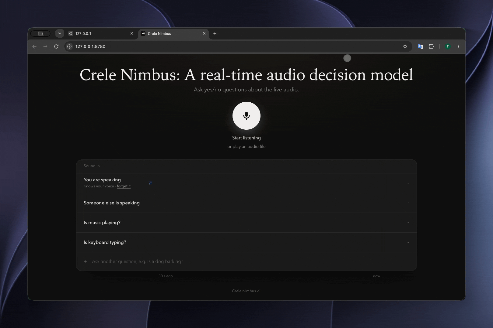

# Crele Nimbus

**A real-time audio decision model.** Stream audio in, ask yes/no questions in plain
English ("Is music playing?", "Is someone typing on a keyboard?"), and get an answer for
every 40 ms of audio, about a tenth of a second after it happens, plus events when an
answer starts and stops. Give it a few seconds of the user's voice, and two built-in
signals follow the user and everyone else, live.

Built for voice agents: barge-in, end of turn, background sounds, another voice in the
room. Open weights, Apache-2.0, real time on a laptop CPU.

The weights: [huggingface.co/crele/nimbus-v1](https://huggingface.co/crele/nimbus-v1).



## Install

```bash
pip install git+https://github.com/Crele-AI/nimbus
```

Python 3.10 or newer and PyTorch 2.4 or newer. Tested on a Mac CPU with Python 3.11 and
3.14 and torch 2.8.0 and 2.15.0; CUDA (`device="cuda"`) is supported but untested.

Two downloads land in the Hugging Face cache on first use, 1.6 GB in all: the weights
(0.4 GB) at `Nimbus.from_pretrained`, and the text encoder that reads the questions
(1.2 GB) at the first `model.session()`.

## Use it

```python
import soundfile as sf
from crele_nimbus import Nimbus

model = Nimbus.from_pretrained("crele/nimbus-v1")
session = model.session()
session.ask("music", "Is music playing?")
session.ask("whistle", "Is someone whistling?", threshold=0.5)
session.ask("noise", "Is it noisy?", yes_means="loud traffic or machines", no_means="silence")

voice, _ = sf.read("user_voice_16k.wav", dtype="float32")   # optional, see below
session.enroll(voice)

for update in session.push(pcm_16k):        # float32 or int16, mono 16 kHz, any length
    for event in update.events:
        print(event.question, event.kind, event.start_s)
    print(update.time_s, update.answers["music"].answer)
session.finish()                            # at the end of a file, not of a live stream
```

- **Audio in**: 16 kHz mono, as float32 in [-1, 1], int16, or raw 16-bit PCM bytes,
  pushed in any chunk length. Resample anything else to 16 kHz first. The model works on
  80 ms chunks and gives two 40 ms answers per chunk, each as its own `Update` with its
  time, so an answer arrives 80 to 120 ms of audio after the moment it describes, plus
  compute.
- **Answers**: per question per 40 ms, `answer` is `yes`, `no` or `cant_tell`, with
  `probability`, the model's probability of yes, and `can_tell`, the probability that it
  can judge at all. `answer` follows the event settings: it turns `yes` once an event has
  started. `session.answers` holds the newest answers.
- **Events**: `started` (with the estimated start and the time it was confirmed) and
  `stopped` (with the end and the duration). `session.events` holds every event of the
  stream so far.
- **Changing questions while streaming**: `ask` adds a question or replaces the one with
  the same id, `remove` drops one, `tune` changes a question's settings. The other
  questions' answers and events carry on; a removed question's open event arrives as
  `stopped` in the next update.

`examples/stream_file.py` runs a WAV file through a session and prints the events.

### The user's voice

Two signals are always there, before your questions: `user` (the user is speaking) and
`other` (someone other than the user is speaking). Both need a reference: pass a few
seconds of the user's speech to `session.enroll`. Without an enrollment, `user` answers
`cant_tell` and `other` cannot tell the user apart from anyone else, so enroll before
relying on either signal. `session.enroll(None)` forgets the voice.

### Reference

| Call | What it does |
|---|---|
| `Nimbus.from_pretrained(path_or_id, device="cpu", text_encoder=None)` | Loads the model from a Hugging Face id or a local folder. `text_encoder` names a local folder with the text encoder's files, for offline use |
| `model.session()` | A new stream. Sessions are cheap; the model is shared between them |
| `session.ask(id, text, yes_means=None, no_means=None, **settings)` | Adds or replaces a question. Ids start with a letter and use letters, digits, `_` and `-`; `user` and `other` are taken. At most 32 questions per session |
| `session.remove(id)`, `session.tune(id, **settings)` | Drops a question; changes its settings without disturbing its events |
| `session.enroll(voice)` | The user's voice, 16 kHz mono, a few seconds of speech; `None` forgets it |
| `session.push(audio)`, `session.finish()`, `session.reset()` | Streams audio in; ends a stream; starts a new one with the same questions and voice |
| `model.release_text_encoder()` | Frees the text encoder's memory; the next new question loads it again |

A session is not thread-safe: call it from one thread. The playground shows the pattern
for async code (a single-thread executor).

## The playground

```bash
python -m crele_nimbus.playground --open
```

Run it with the Python you installed the package into (activate that virtual environment
first). One page on `127.0.0.1:8780`: press the microphone button, or play an audio file,
and watch a row per question answer. Each row's tune icon opens its four settings, and
the "You are speaking" row has "Teach it your voice". The page asks for the raw microphone
(no echo cancellation, no noise suppression, no gain control), because those remove the
sounds you are asking about. No audio is stored. `--help` lists the flags, among them
`--weights` for a local folder and `--device`.

## Tuning

Each question has four settings, named as voice-activity detectors name them. The
defaults apply to every question, and a question can override any of them in `ask` or
`tune`.

| Setting | Default | Meaning |
|---|---:|---|
| `threshold` | 0.70 | the event starts when the probability is at or above this |
| `start_secs` | 0.12 | ... for this long |
| `stop_threshold` | 0.35 | the event stops when the probability is at or below this |
| `stop_secs` | 0.30 | ... for this long |

- A sound is missed: lower `threshold`, try 0.5.
- An event never stops: the probability rests above `stop_threshold` after the sound.
  Raise `stop_threshold` for that question.
- Brief blips start events: raise `start_secs`. Short pauses end them: raise `stop_secs`.
- `stop_threshold` must stay under `threshold`, and setting one never moves the other: to
  set `threshold` to 0.35 or lower, lower `stop_threshold` in the same call. The answer is
  held at `cant_tell` while `can_tell` is under 0.5.

## What to expect

| | Measured |
|---|---|
| Answers every 40 ms, delivered every 80 ms | 80 to 120 ms of audio after the moment, plus compute |
| Real time on a laptop CPU | keeps up with live audio on an Apple M4 Pro CPU with 8 and with 32 questions |
| Says yes about 0.2 s after a sound starts | median 0.24 s over the sounds it caught, on 500 real AudioSet clips with the default settings; speech 0.21 s, 97% of 181 speech onsets caught |
| Ask in your own words | reworded questions it never trained on scored 0.892 against 0.911 on its own wording (mean AUROC, 40 sounds, the same 500 clips) |
| Quiet in a silent room | the highest resting answer 0.03 across twelve sound questions (one room) |
| Tells the user's voice from other voices | shown on a microphone: alone, another voice near and far, turn taking, overlap |
| Size | about 97M parameters on the audio, plus a 0.6B text encoder used once per question |

For example, ask about speech, music, laughing, singing, typing, whistling or sirens.

## Limits

- English questions only.
- One reference voice per session.
- The first second of every stream answers `cant_tell` on every question: the model
  needs that much context.
- Input is 16 kHz mono. Resample 8 kHz phone audio to 16 kHz first; phone audio is
  untested.
- The voice enrollment is a voiceprint, personal data: get consent and store it like any
  personal data. This repository stores nothing.

## How it is built

A streaming audio encoder distilled from Dasheng-Base so that it only hears the past; a
speaker-embedding model (CAM++) for the two voice signals; an unchanged text encoder
(Qwen3-Embedding-0.6B) that reads each question once; and a small decision head that
answers every question against the last three seconds of audio. About 97M parameters run
on the audio: the encoder 85.5M, the head 4.5M, the voice model 7.3M. The weights were
trained on AudioSet and AudioSet-Strong, LibriSpeech, MUSAN and FSD50K, with the AudioSet
ontology behind the questions; the model card on Hugging Face has the details and the
licences.

## Licence and citation

Code and weights are Apache-2.0 (`LICENSE`, `NOTICE`). The voice model's code is copied
from 3D-Speaker under the same licence (`src/crele_nimbus/speaker/PROVENANCE.md`).

```bibtex
@misc{crele2026nimbus,
  title  = {Crele Nimbus v1: a real-time audio decision model},
  author = {Crele},
  year   = {2026},
  url    = {https://huggingface.co/crele/nimbus-v1}
}
```
